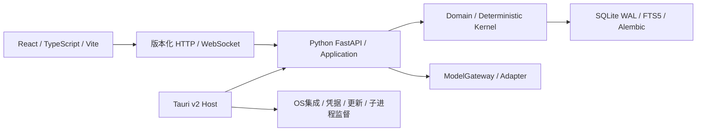

# 系统概览

本页说明当前冻结架构与阅读路径，不维护阶段进度。实现／验收看[状态清单](../PROJECT_STATUS.md)，现行用户行为看[PRODUCT](../../PRODUCT.md)，源码调用链看[HANDOFF](../../HANDOFF.md#3-各部分怎样实现从哪里接手)。早期阶段中的“未实现／待选择”不能作为当前待办。

## 组成与权威边界

| 组成 | 职责 | 必须守住的边界 |
| --- | --- | --- |
| UI／API client | 用户交互、草稿／预览、有限窗口与实时事件 | 不直接写数据库或把隐藏状态展示成全知消息 |
| Tauri宿主 | Core监督、安全凭据管道、本地模型服务、文件／系统操作和更新 | 保持应用标识／存档位置；未知任务不重放、未知进程不关闭 |
| Application／Director | 编排一次性任务、批量提案、预算／路由与获准输入，并记录有界后台诊断 | 不直接把LLM结果变权威事实，失败不静默重复付费请求；诊断不含私密正文或凭据 |
| Character Agent | 基于本人权限、人格与记忆表达 | 不接收全部世界秘密，不伪造活动／关系成果 |
| Domain／Kernel | 验证命令、计划与revision，原子提交canonical事件／投影／回执 | CAS、幂等、知识来源和旧事件重放兼容 |
| Persistence | SQLite WAL、FTS5、资产／来源索引、Alembic迁移 | Alembic为唯一迁移authority；聊天／内容与canonical事件不是同一种数据 |

知识权限先于检索和提示组装；WorldTruth、CharacterBelief、PlayerKnowledge分开。Player只有一个位置；通信不等于现场观察。持久创作预览确认与校验后直接发送的运行台词分开。详细批准阈值及费用边界在[产品约定](../../PRODUCT.md)，不在概览复制。

## 组合与协调的源码边界

| 入口 | 当前职责与接续规则 |
| --- | --- |
| adapters/http/app.py、services.py | 工厂接收类型化 HttpServices；生产 cli 只调用 create_product_app，在监听和 ready 前拒绝缺少的必需服务。开发者视图、宿主存储回调及未配置模型时的回复生成服务允许缺省，聊天读取／发送服务仍必需；精简 create_app 用于明确的局部嵌入。路由依赖在模块顶部导入。 |
| application/command_handler.py | 负责幂等恢复、事务、统一事件／回执／提交；command_locations、command_participants、command_relationships、command_knowledge 负责各命令校验和投影写入，返回 CommandMutation。它们不能自行 commit 或另开事务。 |
| infrastructure/llm/adapter_support.py | 共享非负整数计数校验、诊断标识脱敏和失败封装。payload、缓存计数和推理 Token 关系留在协议适配器；硬预留与结算仍由 application/llm_execution.py 统一负责。 |
| adapters/http/wire_contracts、contracts.py | 按业务模块维护 JSON 响应，兼容 facade 导出；实际 HTTP 请求模型静态生成 TypeScript 类型。客户端 JSON 读写与流式进度统一使用生成契约，二进制及宿主协议独立。详见[开发说明](../DEVELOPMENT.md#类型与业务契约)。 |
| ProductApp.tsx | 组合页面；导航、草稿保护、会话目录、身份、事件、世界时钟及操作反馈由各自 useWorkspace／useWorld hooks 管理；useDesktopPresence 管理宿主租约。世界／玩家切换清除事件草稿、取消读取并拒绝迟到结果；私聊／群聊选择互斥，不自动重放生成。 |
| updater.rs、updater/check.rs、updater/package.rs | 更新协调入口、有限频道检查、包完整性与受控文件操作分开；签名、持久交接和回滚顺序保持。 |
| save_safety.py、save_database.py、save_errors.py | 快照／恢复目录协调与数据库账本保护、任务隔离、连续性核对分开；动态标识符集中检查并引用，值仍参数绑定。旧公开入口保留，未更改存档格式／迁移。 |

这些拆分沿既有架构，没有新增运行框架；静态／隔离回归与真实用户升级的证据分别登记在状态清单。

## 按任务选读

| 任务 | 技术契约 |
| --- | --- |
| 命令、存储与回放 | [领域](DOMAIN_MODEL.md)、[命令](COMMAND_MODEL.md)、[事件](EVENT_MODEL.md)、[持久化](PERSISTENCE_MODEL.md)、[重放](REPLAY_MODEL.md) |
| 知识与记忆 | [知识](KNOWLEDGE_MODEL.md)、[访问控制](KNOWLEDGE_ACCESS_MODEL.md)、[亲历](EPISODIC_MEMORY.md)、[记忆模型](MEMORY_MODEL.md) |
| 资料与格式 | [内容](CONTENT_MODEL.md)、[导入](IMPORT_MODEL.md)、[导出](EXPORT_MODEL.md)、[原生内容包](NATIVE_CONTENT_PACKAGE.md) |
| 聊天与规划 | [聊天](CHAT_MODEL.md)、[Director](DIRECTOR_MODEL.md)、[动作解析](ACTION_RESOLUTION.md)、[时间恢复](CLOCK_RECONCILIATION.md) |
| LLM接入与计费 | [生产组装](LLM_PRODUCTION_COMPOSITION.md)、[基础设施](LLM_INFRASTRUCTURE.md)、[路由](LLM_ROUTING.md)、[账本](LLM_ACCOUNTING.md) |
| 决策与历史 | [ADR](ADR/README.md)、[研究](../research/README.md)、[历史阶段证据](../history/README.md) |

PostgreSQL／pgvector是未来服务端方向，MySQL／Qdrant为后续可评估方案；当前没有因此引入新服务。Redis只在真实分布式需求出现时评估。本地检索复用jieba、FTS5、FastEmbed／BGE、NumPy与DiskCache。固定 BGE-small-zh-v1.5 的 ONNX 权重由[准备脚本](../../scripts/prepare-semantic-model.py)固定revision、校验权重SHA256并登记MIT许可，经[Core打包配置](../../scripts/dreamtalk-core.spec)随独立 Core 分发；运行时不下载模型，也不向外部 embedding 服务发送历史。用户另行部署的配音／视觉模型环境和权重保持独立，不进入安装载荷。

改动框架、数据库、Kernel authority或知识隔离须用户决定；普通实现选择采用满足已确认需求的简单方案。研究／历史验收报告用于追溯证据，不能给未批准方向授予实现或运行权限。
